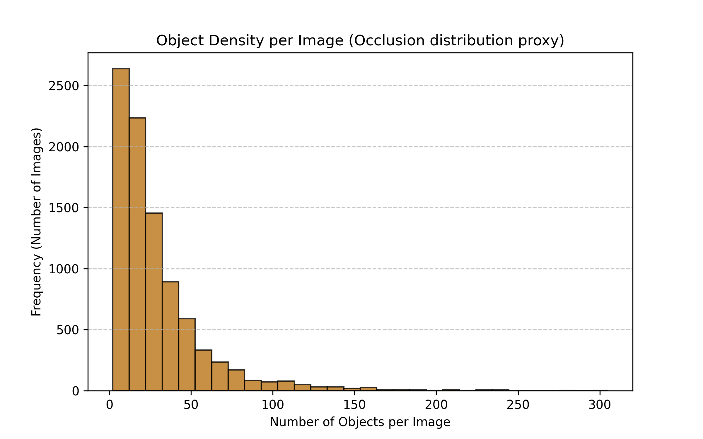

# LARD: Lightweight Attention-Augmented Real-Time Detection

**Occlusion-robust pedestrian detection on edge hardware: a 2.2M-parameter YOLOv5n-based detector with a compact channel-and-spatial attention module, deployed as a TensorRT INT8 engine on an NVIDIA Jetson Nano.**


## Motivation

Fixed cameras in shopping centres, campuses and warehouses often see people who are partly hidden by other people, bags, pillars or furniture. Compact detectors that fit on low-cost edge devices have limited capacity to recognise a person from fragments such as a head, a shoulder or part of a torso. LARD tests whether a lightweight attention module, together with occlusion-oriented training, can keep useful recall under partial visibility within a Jetson Nano budget.

## Approach

| Component | Design |
|---|---|
| Backbone | YOLOv5n configuration, single class (person), **2.2 M parameters** |
| Attention | **CSAM**, a compact channel-and-spatial attention block adapted from CBAM and placed in the PANet neck |
| Initialisation | MS-COCO 2017, then fine-tuned on CrowdHuman |
| Occlusion-oriented training | CoarseDropout synthetic occlusion, Mosaic and MixUp augmentation, focal objectness loss (γ = 1.5) |
| Deployment | TensorRT INT8 engine on Jetson Nano 4 GB |

### Reproducible occlusion protocol

The protocol uses 874 fixed CrowdHuman validation images in three tiers of synthetic occlusion applied to each ground-truth box:

- **Tier 1**: no added occlusion
- **Tier 2**: 30–50 % of each box covered
- **Tier 3**: 50–70 % of each box covered

## Results

| Metric | Value |
|---|---|
| mAP@0.5 (full CrowdHuman val, 4,370 images) | **0.604** |
| mAP@0.5:0.95 | **0.328** |
| Recall, Tier 1 → Tier 3 (standard inference) | 0.553 → 0.146 |
| Relative recall gain of enhanced inference (Tiers 1 / 2 / 3) | +18.8 % / +36.8 % / **+58.2 %** |
| Jetson Nano latency (TensorRT INT8) | **< 30 ms / frame (~33 FPS)** |
| Peak memory on Jetson Nano | < 1.8 GB |

Enhanced inference combines test-time augmentation, an 832 px input, a lower confidence threshold and a higher NMS threshold. It trades precision for recall. Real-scene tests on a university campus showed the model detecting partially visible people. The recall-oriented settings also produced more false positives in cluttered scenes.

<p align="center">
  
  <br><em>Objects per image in CrowdHuman training data, a proxy for how crowded and occluded scenes are.</em>
</p>

## What is in this repository

This repository currently holds the **data-preparation and augmentation tooling** used in the study:

| File | Purpose |
|---|---|
| `scripts/setup_datasets.py` | Creates the YOLO-format folder structure for COCO, CrowdHuman, Caltech Pedestrian and MOT, and downloads or explains each dataset |
| `scripts/download_crowdhuman.py` | Downloads CrowdHuman in YOLOv5 format through Roboflow and reorganises it into train/val/test |
| `scripts/augmentation_script.py` | Albumentations CoarseDropout pipeline that simulates occlusion on YOLO-labelled images, with a before/after visualisation |

```bash
pip install albumentations opencv-python matplotlib roboflow
export ROBOFLOW_API_KEY=<your key>        # Windows: set ROBOFLOW_API_KEY=<your key>
python scripts/setup_datasets.py
python scripts/download_crowdhuman.py
python scripts/augmentation_script.py
```

The full training configuration, the occlusion-tier evaluation scripts, the list of the 874 evaluation images and the trained weights will be published here once the paper is accepted.

## Roadmap

- Ablation without CSAM to isolate its contribution
- Comparison against YOLOv5n, YOLOv5n + CBAM and YOLOv8n under the same protocol and device
- Power and thermal profiling during sustained inference
- Repeated training runs with confidence intervals
- Evaluation on annotated real-world occlusion data

## Authors

Muhammad Adnan, Ayaan Aatif, Abdul Rahim Memon, Muhammad Moeen ul Haq Farooqi and Muhammad Moazzam Ali. School of Electrical Engineering and Computer Science (SEECS), NUST, Islamabad.

## Data

CrowdHuman, MS-COCO 2017 and MOT17 are public datasets under their own licenses and are not redistributed here.

## License

Code is released under the [MIT License](LICENSE).
